# nf-core/eupathpopgen: Usage

## Introduction

Provide exactly one of:

- `--allele_table` — PGEcore allele-table TSV
- `--pmo` — [Portable Microhaplotype Object](https://plasmogenepi.github.io/PMO_Docs/) JSON (allele table extracted with pmotools)

Optional population stratification via `--population_assignment`, or (with `--pmo`) `--pmo_population_fields`. Without either, all samples are analysed as one group labelled by `--population_label` (default `pop1`).



## Allele table

Required columns (see [PGEcore input-formats](https://plasmogenepi.github.io/PGEcore/articles/input-formats.html)):

| Column          | Description                                  |
| --------------- | -------------------------------------------- |
| `specimen_name` | Sample / specimen ID                         |
| `target_name`   | Locus / amplicon ID                          |
| `seq`           | Allele sequence                              |
| `reads`         | Read count (needed for naive COI and Dcifer) |

## PMO input

```bash
nextflow run nf-core/eupathpopgen \
  -profile docker,plasmodium \
  --pmo input.json \
  --pmo_population_fields "collection_country,collection_date" \
  --outdir results
```

- `--pmo_population_fields` — comma-separated specimen metadata fields joined into `population` labels
- `--pmo_population_separator` — join string (default `_`)
- `--population_assignment` — if set, overrides PMO-derived population labels
- `--population_label` — single-population label when no assignment is provided (default `pop1`)

Extracted allele table / population assignment are published under `pipeline_info/pmo/`.

## Running the pipeline

```bash
nextflow run nf-core/eupathpopgen \
  -profile docker,plasmodium \
  --allele_table alleles.tsv \
  --outdir results
```

### Profiles

| Profile                                     | Purpose                                                                               |
| ------------------------------------------- | ------------------------------------------------------------------------------------- |
| `plasmodium`                                | Plasmodium-validated defaults (`--coi_method naive`, all relatedness/AF estimates on) |
| `test`                                      | Shared drugres allele table from test-datasets; naive COI only                        |
| `test_pmo`                                  | Shared drugres example PMO (+ `collection_country` population fields); naive COI only |
| `test_full`                                 | Allele table + population assignment; MOIRE COI + AF + relatedness (reduced MCMC)     |
| `docker` / `singularity` / `conda` / `wave` | Standard nf-core executors                                                            |

### Estimates (not tools)

| Parameter                         | Meaning                                                                                                                                                              |
| --------------------------------- | -------------------------------------------------------------------------------------------------------------------------------------------------------------------- |
| `--coi_method`                    | `naive`, `moire`, or a comma-separated list such as `naive,moire` (COI is always estimated; multiple methods are combined into one table with a `coi_method` column) |
| `--naive_coi_method`              | `integer_method` or `quantile_method` when `--coi_method` includes `naive`                                                                                           |
| `--naive_coi_threshold`           | Integer index or quantile in \[0, 1]                                                                                                                                 |
| `--skip_allele_frequencies`       | Skip allele-frequency outputs (currently from MOIRE)                                                                                                                 |
| `--skip_within_host_relatedness`  | Skip within-host relatedness outputs (currently from MOIRE)                                                                                                          |
| `--skip_between_host_relatedness` | Skip between-host IBD outputs (currently from Dcifer)                                                                                                                |

Per-locus allele counts and popgen summaries always run.

MOIRE is invoked **at most once**. It runs when `--coi_method` includes `moire` and/or allele frequencies / within-host relatedness are requested. Skipped MOIRE-backed estimates are not published even if produced as intermediates.

### Test data

`-profile test` / `test_pmo` / `test_full` use inputs from the [`eupathpopgen` branch of nf-core/test-datasets](https://github.com/nf-core/test-datasets/tree/eupathpopgen) (shared with plasmodiumdrugres).

### Software notes

All tools come from conda (bioconda / conda-forge) or matching Seqera community containers built per module for linux/amd64 and linux/arm64.

### MOIRE / Dcifer tuning

Optional hidden `--moire_*` and `--dcifer_*` parameters (see `--help --show_hidden`) map to PGEcore wrapper flags via `conf/tools.config`. Leave them unset to use the wrapper defaults. Thread counts come from the process `cpus`, so set those through a custom config rather than a parameter.

## Outputs

See [output.md](output.md).
